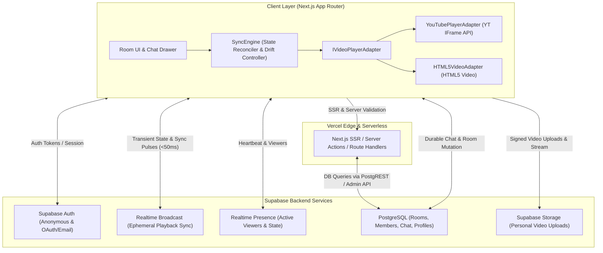
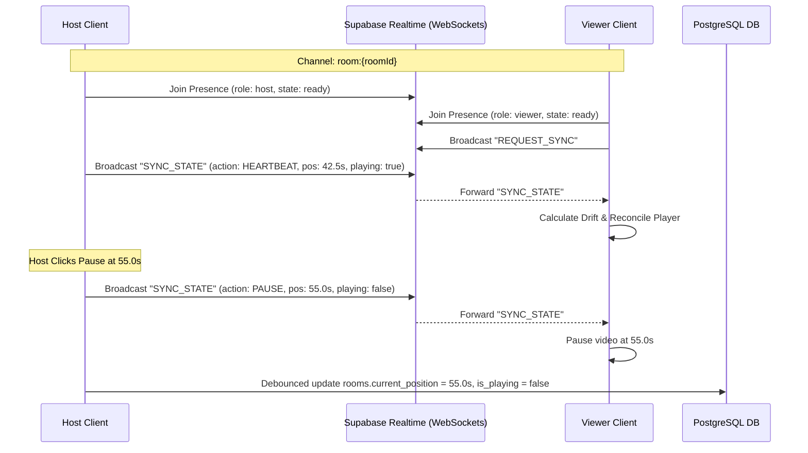

# ARCHITECTURE.md — Syncora System Architecture

## 1. High-Level Architecture Diagram



---

## 2. Component Responsibilities & Modularity

### 2.1 Video Player Adapter Abstraction (`IVideoPlayerAdapter`)
The core synchronization engine must remain completely agnostic of underlying video providers. It interacts strictly via an interface:

```typescript
export interface PlaybackState {
  currentTime: number;
  duration: number;
  isPlaying: boolean;
  playbackRate: number;
  bufferedTime: number;
  isBuffering: boolean;
}

export type PlayerEventType = 
  | 'PLAY'
  | 'PAUSE'
  | 'SEEKED'
  | 'BUFFERING'
  | 'READY'
  | 'ENDED'
  | 'ERROR'
  | 'RATE_CHANGE';

export interface IVideoPlayerAdapter {
  initialize(containerElement: HTMLElement, initialUrl: string): Promise<void>;
  play(): Promise<void>;
  pause(): Promise<void>;
  seekTo(seconds: number): Promise<void>;
  setPlaybackRate(rate: number): void;
  setVolume(volume: number): void;
  getPlaybackState(): PlaybackState;
  loadVideo(videoUrl: string): Promise<void>;
  destroy(): void;
  on(event: PlayerEventType, handler: (state: PlaybackState) => void): void;
  off(event: PlayerEventType, handler: (state: PlaybackState) => void): void;
}
```

- **`YouTubePlayerAdapter`**: Injects YouTube IFrame API script dynamically, binds to `YT.PlayerState` transitions, handles YouTube's specific postMessage latency and autoplay restrictions (e.g., initial muted playback if unmuted autoplay is blocked by browser policy).
- **`HTML5VideoAdapter`**: Directly binds to `<video>` events (`play`, `pause`, `seeking`, `seeked`, `timeupdate`, `waiting`, `canplay`). Handles MP4/WebM files and Supabase Storage public/signed URLs.

---

## 3. Host-Authoritative Playback Synchronization Algorithm

### 3.1 Timing Model & Clock Skew Compensation
Each sync payload includes the host's high-resolution timestamp:

```typescript
export interface SyncStatePayload {
  version: number;
  roomId: string;
  hostId: string;
  action: 'PLAY' | 'PAUSE' | 'SEEK' | 'HEARTBEAT' | 'LOAD_VIDEO';
  position: number;       // Position in seconds at host timestamp
  isPlaying: boolean;     // Whether host video is currently playing
  playbackRate: number;  // 1.0, 1.25, etc.
  sentAt: number;         // Epoch timestamp (performance.timeOrigin + performance.now() or Date.now())
}
```

When a viewer receives a payload at local time `receivedAt`:
1. **Transit Latency Compensation**:
   $$\Delta t_{transit} = \max(0, \text{receivedAt} - \text{sentAt})$$
   *(Note: Clock skew between host and client can be calibrated on channel join via a quick 3-way ping-pong NTP-lite exchange).*
2. **Projected Authoritative Timestamp**:
   $$t_{expected} = \begin{cases} 
      \text{payload.position} + \left(\frac{\text{now} - \text{payload.sentAt}}{1000}\right) \times \text{payload.playbackRate} & \text{if payload.isPlaying} \\
      \text{payload.position} & \text{if } \neg\text{payload.isPlaying}
   \end{cases}$$
3. **Drift Calculation**:
   $$\text{Drift} = t_{local} - t_{expected}$$

### 3.2 Drift Reconciliation Ladder
To guarantee a non-jarring viewing experience, drift corrections are tiered:

| Drift Magnitude ($|\text{Drift}|$) | Correction Strategy | User Perception |
| :--- | :--- | :--- |
| **$< 500\text{ms}$** | **No action** (Deadband zone) | Completely seamless, prevents audio jitter |
| **$500\text{ms} \le \text{Drift} \le 2000\text{ms}$** | **Dynamic Playback Rate Nudge** (e.g. adjust to $1.05\times$ if behind, $0.95\times$ if ahead) | Smooth catchup without audio distortion |
| **$> 2000\text{ms}$** | **Hard Seek** directly to $t_{expected}$ | Immediate resynchronization |

### 3.3 Loop Prevention
Whenever the local player adjusts state in response to an incoming remote broadcast, it sets an internal flag `isRemoteSyncing = true`. Any local player events triggered by programmatic manipulation do NOT emit broadcast events back to the room.

---

## 4. Database Schema (PostgreSQL with Supabase RLS)

```sql
-- Enable UUID extension
CREATE EXTENSION IF NOT EXISTS "uuid-ossp";

-- PROFILES (User identity model, designed for seamless upgrade to Supabase Auth)
CREATE TABLE public.profiles (
    id UUID PRIMARY KEY DEFAULT gen_random_uuid(),
    username TEXT NOT NULL CHECK (char_length(username) >= 1 AND char_length(username) <= 30),
    avatar_url TEXT,
    is_guest BOOLEAN DEFAULT true,
    created_at TIMESTAMPTZ DEFAULT TIMEZONE('utc', NOW()) NOT NULL,
    updated_at TIMESTAMPTZ DEFAULT TIMEZONE('utc', NOW()) NOT NULL
);

-- ROOMS (Authoritative room metadata and durable playback snapshot)
CREATE TABLE public.rooms (
    id UUID PRIMARY KEY DEFAULT gen_random_uuid(),
    code TEXT UNIQUE NOT NULL CHECK (char_length(code) >= 6),
    title TEXT NOT NULL CHECK (char_length(title) >= 1 AND char_length(title) <= 100),
    host_id UUID NOT NULL REFERENCES public.profiles(id) ON DELETE RESTRICT,
    video_type TEXT NOT NULL CHECK (video_type IN ('youtube', 'url', 'upload')),
    video_url TEXT NOT NULL,
    current_position FLOAT DEFAULT 0.0 NOT NULL,
    is_playing BOOLEAN DEFAULT false NOT NULL,
    last_synced_at TIMESTAMPTZ DEFAULT TIMEZONE('utc', NOW()) NOT NULL,
    is_private BOOLEAN DEFAULT true NOT NULL,
    passcode_hash TEXT,
    created_at TIMESTAMPTZ DEFAULT TIMEZONE('utc', NOW()) NOT NULL,
    updated_at TIMESTAMPTZ DEFAULT TIMEZONE('utc', NOW()) NOT NULL
);

-- ROOM MEMBERS (Membership & Role tracking)
CREATE TABLE public.room_members (
    id UUID PRIMARY KEY DEFAULT gen_random_uuid(),
    room_id UUID NOT NULL REFERENCES public.rooms(id) ON DELETE CASCADE,
    user_id UUID NOT NULL REFERENCES public.profiles(id) ON DELETE CASCADE,
    role TEXT NOT NULL DEFAULT 'viewer' CHECK (role IN ('host', 'co-host', 'viewer')),
    joined_at TIMESTAMPTZ DEFAULT TIMEZONE('utc', NOW()) NOT NULL,
    last_seen_at TIMESTAMPTZ DEFAULT TIMEZONE('utc', NOW()) NOT NULL,
    UNIQUE(room_id, user_id)
);

-- CHAT MESSAGES (Durable room chat history)
CREATE TABLE public.chat_messages (
    id UUID PRIMARY KEY DEFAULT gen_random_uuid(),
    room_id UUID NOT NULL REFERENCES public.rooms(id) ON DELETE CASCADE,
    user_id UUID NOT NULL REFERENCES public.profiles(id) ON DELETE CASCADE,
    content TEXT NOT NULL CHECK (char_length(content) >= 1 AND char_length(content) <= 1000),
    type TEXT NOT NULL DEFAULT 'chat' CHECK (type IN ('chat', 'system')),
    created_at TIMESTAMPTZ DEFAULT TIMEZONE('utc', NOW()) NOT NULL
);

-- INDEXES FOR LOW-LATENCY LOOKUPS
CREATE INDEX idx_rooms_code ON public.rooms(code);
CREATE INDEX idx_room_members_room ON public.room_members(room_id);
CREATE INDEX idx_room_members_user ON public.room_members(user_id);
CREATE INDEX idx_chat_messages_room_created ON public.chat_messages(room_id, created_at ASC);
```

### 4.1 Row-Level Security (RLS) Policies
1. **`profiles`**:
   - `SELECT`: Publicly readable by authenticated/anonymous users.
   - `INSERT/UPDATE`: Only the user matching `auth.uid() = id`.
2. **`rooms`**:
   - `SELECT`: Anyone knowing the `code` or `id` (or room member).
   - `INSERT`: Authenticated or verified anonymous users.
   - `UPDATE`: Only the current `host_id` matching `auth.uid()`.
   - `DELETE`: Only the `host_id` matching `auth.uid()`.
3. **`room_members`**:
   - `SELECT`: Members of the same room.
   - `INSERT`: User can insert themselves as viewer (or host if creating).
   - `UPDATE/DELETE`: User can remove themselves; Host can manage members.
4. **`chat_messages`**:
   - `SELECT`: Any member of the room.
   - `INSERT`: Verified members of the room with `auth.uid() = user_id`.

---

## 5. Realtime Architecture & Channel Design



---

## 6. Security & Credentials Architecture

- **Public Client Variables**:
  - `NEXT_PUBLIC_SUPABASE_URL`: Supabase project URL.
  - `NEXT_PUBLIC_SUPABASE_PUBLISHABLE_KEY`: Safe public publishable key (`sb_publishable_...`, protected by RLS; with legacy `NEXT_PUBLIC_SUPABASE_ANON_KEY` fallback).
- **Server-Only Variables**:
  - `SUPABASE_SECRET_KEY`: Used exclusively inside Next.js Route Handlers / Server Actions for administrative operations (e.g. storage signed uploads verification, host failover escalation; with legacy `SUPABASE_SERVICE_ROLE_KEY` fallback). Never leaked to browser bundles.
- **Authentication**:
  - Supabase Anonymous Sign-In enabled to support zero-friction guest joins while maintaining cryptographically signed JWT sessions for RLS.
  - Optional Email / OAuth sign-in to claim and retain permanent rooms.

---

## 7. Two-Person Voice Calling Architecture (Phase 10)

Syncora supports voice-only 1:1 WebRTC calls inside watch rooms (`MAX_CALL_PARTICIPANTS = 2`), while watch-room capacity remains `MAX_ROOM_PARTICIPANTS = 4`.

```mermaid
sequenceDiagram
    participant CallerA as Caller A (Browser)
    participant SupabaseDB as PostgreSQL (RLS + Advisory Lock)
    participant NextAPI as Vercel API (/call/ice-servers)
    participant Realtime as Private Realtime Outboxes
    participant CallerB as Caller B (Browser)

    CallerA->>CallerA: getUserMedia({ audio: AEC/NS/AGC, video: false })
    CallerA->>SupabaseDB: rpc('join_room_call', roomId)
    Note over SupabaseDB: pg_advisory_xact_lock + 60s TTL prune + MAX 2 cap
    CallerA->>NextAPI: POST /api/rooms/[id]/call/ice-servers
    NextAPI-->>CallerA: STUN-only (dev) or Short-Lived Cloudflare TURN
    CallerA->>Realtime: Subscribe private call:{roomId}:{A} + call:{roomId}:{B}
    CallerA->>Realtime: media-state ready handshake -> Perfect Negotiation
    Realtime-->>CallerB: Verified sender via topic RLS (auth.uid() = A)
    CallerA<-->CallerB: Direct DTLS-SRTP Audio (P2P or Cloudflare TURN)
```

### 7.1 Server-Side Slot Enforcement & Zero Media Persistence
- **`public.room_call_participants`**: Stores only `(room_id, user_id, call_session_id, joined_at, last_heartbeat_at)`. Direct browser `INSERT`/`UPDATE`/`DELETE` is disabled; all slot changes execute through `join_room_call`, `heartbeat_room_call`, and `leave_room_call` RPCs (plus `POST /api/rooms/[id]/call/leave` via `navigator.sendBeacon` on `pagehide`).
- **Zero Persistence**: Audio streams, SDP offers/answers, and ICE candidates are never stored in PostgreSQL or application logs.

### 7.2 Anti-Spoofing Signaling & Validation
- Every caller publishes only to `call:{roomId}:{selfUserId}` (`INSERT` RLS requires `auth.uid() = selfUserId`, room membership, and an active slot in `room_call_participants`). Only active callers in that room may `SELECT` `call:{roomId}:*`.
- [`callSignalValidation.ts`](file:///home/sid/Desktop/Cinemate/src/core/call/callSignalValidation.ts) enforces protocol version `1`, `roomId`, `targetUserId`, UUID `callSessionId`, `16 KB` audio-only SDP (rejecting `m=video` and `m=application`), `1 KB` ICE bounds, and a 30/sec sliding-window inbound rate limiter.
- [`PeerConnectionManager.ts`](file:///home/sid/Desktop/Cinemate/src/core/call/PeerConnectionManager.ts) resolves simultaneous joins using **Perfect Negotiation** (`polite = selfUserId < peerUserId`), buffers early ICE candidates, and runs exponential-backoff ICE restarts on transient drops.

### 7.3 Independent Lifecycle & Non-Obstructive UI
- [`useCall.ts`](file:///home/sid/Desktop/Cinemate/src/hooks/useCall.ts) and the remote `<audio>` element live in [`RoomView.tsx`](file:///home/sid/Desktop/Cinemate/src/components/room/RoomView.tsx) outside [`UniversalPlayer.tsx`](file:///home/sid/Desktop/Cinemate/src/components/player/UniversalPlayer.tsx), ensuring video source switches, seeks, pauses, and player remounts never interrupt voice calls.
